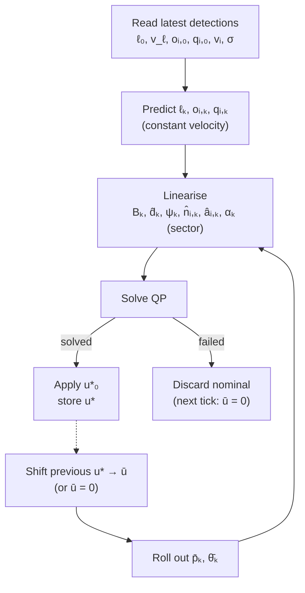

# Leader-Following MPC

At each tick the controller predicts the leader and obstacles over a short horizon
and solves one convex QP for the robot's body-velocity commands. The QP keeps the
robot a fixed distance from the leader, turned to face it, clear of obstacles, with
an unobstructed line of sight to the leader, and moving in directions the lidar can
see. The nonlinear kinematics and the non-convex distance terms are linearised around
the previous optimal input sequence, shifted by one step. Only the first input is
applied (receding horizon).

---

## 1. Notation

| Symbol | Value | Meaning |
|---|---|---|
| $N$ | $20$ | prediction horizon |
| $\Delta t$ | $0.1\,\text{s}$ | sampling time ($1/\text{rate}$) |
| $x_k = [p_k^\top,\ \theta_k]^\top \in \mathbb R^3$ | | robot position $p_k$ and yaw $\theta_k$ |
| $u_k = [v_{x,k},\ v_{y,k},\ \omega_k]^\top \in \mathbb R^3$ | | body-frame velocity command |
| $\bar p_k,\ \bar\theta_k,\ \bar u_k$ | | nominal pose and input, rolled out from the previous solution |
| $\ell_k,\ v_\ell$ | | leader position and velocity |
| $\sigma_\ell,\ \sigma_{v,\ell}$ | | leader position and velocity standard deviation |
| $o_{i,k},\ v_i$ | | nearest point and velocity of obstacle $i = 1,\dots,M$, $M \le 10$ |
| $q_{i,k}$ | | line-of-sight point of obstacle $i$: the obstacle point closest to the robot–leader line of sight |
| $\hat d_k,\ \hat d_k^\perp$ | | unit direction to the leader and its left normal |
| $\hat n_{i,k},\ \hat a_{i,k}$ | | unit normals of the obstacle and line-of-sight half-planes |
| $\sigma_i,\ \sigma_{v,i}$ | | obstacle position and velocity standard deviation |
| $m_\ell$ | $2\,\text{m}$ | leader distance |
| $m_s,\ m_h$ | $2\,\text{m},\ 1\,\text{m}$ | soft and hard obstacle margins |
| $m_{los}$ | $1\,\text{m}$ | line-of-sight margin |
| $s_{i,k} \ge 0$ | | obstacle slack |
| $l_{i,k} \ge 0$ | | line-of-sight slack |
| $c_m$ | $50$ | obstacle slack weight |
| $\varphi$ | $1.4\,\text{rad}\ (\approx 80^\circ)$ | full-vision half-angle of the lidar |
| $v^{full},\ v^{part},\ v^{poor}$ | $2,\ 1,\ 0.5\,\text{m/s}$ | speed limits per vision sector |
| $\omega_{\max}$ | $1\,\text{rad/s}$ | yaw-rate limit |
| $z^{cone}_k,\ z^{back}_k \ge 0$ | | vision penalty slacks |

Everything is expressed in the robot body frame at the solve instant, so $x_0 = 0$.
Agent velocities are relative to the ground. Latency is neglected.

---

## 2. Plant model

The Go2 is treated as an ideal omnidirectional body-velocity tracker (no leg dynamics
or slip). With forward Euler:

$$
x_{k+1} = x_k + \Delta t\, B(\theta_k)\, u_k,
\qquad
B(\theta) = \begin{bmatrix} \cos\theta & -\sin\theta & 0 \\ \sin\theta & \cos\theta & 0 \\ 0 & 0 & 1 \end{bmatrix}.
$$

To make this linear, the rotation is frozen along the nominal heading,
$B_k := B(\bar\theta_k)$. The nominal is the previous solution $u^-$ shifted by one
step, $\bar u_k = u^-_{\min(k+1,\,N-1)}$, then rolled out:

$$
\bar x_0 = 0, \qquad \bar x_{k+1} = \bar x_k + \Delta t\, B(\bar\theta_k)\,\bar u_k .
$$

If there is no valid previous solution, $\bar u_k = 0$ and $B_k = I$.

---

## 3. Leader model

The leader moves at constant velocity:

$$
\ell_k = \ell_0 + k\Delta t\, v_\ell .
$$

Velocity estimates that are not significant are zeroed: $\lVert v_\ell\rVert < 2\sigma_{v,\ell} \Rightarrow v_\ell := 0$.

The direction to the leader from the nominal pose is

$$
\hat d_k = \frac{\ell_{k+1} - \bar p_{k+1}}{\lVert \ell_{k+1} - \bar p_{k+1}\rVert}.
$$

The position uncertainty grows along the horizon with the velocity uncertainty:

$$
\sigma_{\ell,k} = \sigma_\ell + (k+1)\Delta t\, \sigma_{v,\ell}.
$$

The distance target is pulled toward the robot by this amount, so the leader is never
assumed to be further away than it may be:

$$
\tilde\ell_{k+1} = \ell_{k+1} - \sigma_{\ell,k}\,\hat d_k .
$$

$\hat d_k$ itself is computed from the unshifted $\ell_{k+1}$.

---

## 4. Obstacle model

Each detection $o_{i,0}$ is the obstacle point nearest to the robot. Obstacles also
move at constant velocity, with the same $2\sigma$ gating:

$$
o_{i,k} = o_{i,0} + k\Delta t\, v_i .
$$

The direction to each obstacle from the nominal pose is

$$
\hat n_{i,k} = \frac{o_{i,k+1} - \bar p_{k+1}}{\lVert o_{i,k+1} - \bar p_{k+1}\rVert}.
$$

The obstacle margins are inflated by the obstacle uncertainty, which grows along the
horizon:

$$
\delta_{i,k} = \sigma_i + (k+1)\Delta t\, \sigma_{v,i}.
$$

### Line-of-sight point

Alongside the nearest point, each detection gives a line-of-sight point $q_{i,0}$:
the obstacle point closest to the line of sight from the robot to the leader. It
moves with the obstacle,

$$
q_{i,k} = q_{i,0} + k\Delta t\, v_i,
\qquad
r_{i,k} = q_{i,k+1} - \bar p_{k+1}.
$$

The point only matters when it lies between the robot and the leader:

$$
0 < \hat d_k^\top r_{i,k} < \lVert \ell_{k+1} - \bar p_{k+1}\rVert .
$$

In that case the side normal of the line of sight points toward the obstacle:

$$
\hat d_k^\perp = \begin{bmatrix} -\hat d_{k,y} \\ \hat d_{k,x} \end{bmatrix},
\qquad
\hat a_{i,k} = \operatorname{sign}\!\big(\hat d_k^{\perp\top} r_{i,k}\big)\, \hat d_k^\perp .
$$

At most the $10$ nearest obstacles are used.

---

## 5. Lidar vision sectors

The robot's own body and legs block part of the lidar's view. The measured share of
blocked returns per azimuth (from `lidar_ranges`) is:

| Azimuth from sensor | Blocked |
|---|---|
| $-75^\circ \dots +75^\circ$ | $0\,\%$ ($\le 0.4\,\%$): always clear |
| $\pm 80^\circ \dots \pm 100^\circ$ | $4$–$14\,\%$ |
| $\pm 100^\circ \dots \pm 130^\circ$ | $9$–$40\,\%$ |
| $\pm 130^\circ \dots \pm 155^\circ$ | $40$–$49\,\%$ (the legs) |
| $\pm 155^\circ \dots 180^\circ$ | $7$–$30\,\%$ |

The robot should only move fast in directions where it can see obstacles. The nominal
direction of travel is

$$
\alpha_k = \big|\operatorname{atan2}(\bar v_{y,k},\ \bar v_{x,k})\big| ,
$$

and the table is split into three sectors:

| Sector | Direction | Blocked |
|---|---|---|
| full vision | $\alpha_k < 1.4\,\text{rad}\ (\approx 80^\circ)$ | $\le 0.4\,\%$ |
| partial vision | $1.4 \le \alpha_k < 2.3\,\text{rad}\ (\approx 130^\circ)$ | $4$–$40\,\%$ |
| poor vision (backwards) | $\alpha_k \ge 2.3\,\text{rad}$ | includes the $40$–$49\,\%$ leg band |

The sector sets the speed limits in §6. The edge of the full-vision sector,
$\varphi = 1.4\,\text{rad}$, also defines the cone penalty in §6 and §7.

---

## 6. Constraints

For $k = 0,\dots,N-1$ and $i = 1,\dots,M$:

$$
\begin{aligned}
& x_0 = 0, \\
& x_{k+1} = x_k + \Delta t\, B_k u_k, \\
& \lvert\omega_k\rvert \le \omega_{\max}, \\
& \hat n_{i,k}^\top\big(o_{i,k+1} - p_{k+1}\big) \ge m_s + \delta_{i,k} - s_{i,k}, \\
& 0 \le s_{i,k} \le m_s - m_h , \\
& \hat a_{i,k}^\top\big(q_{i,k+1} - p_{k+1}\big) \ge m_{los} + \delta_{i,k} - l_{i,k}
  \quad \text{(only while the LOS point is active, §4)}, \\
& l_{i,k} \ge 0 .
\end{aligned}
$$

The obstacle constraint replaces the non-convex disk exclusion
$\lVert o - p\rVert \ge m_s$ with a half-plane that touches the disk at the nominal.
Since $\lVert o-p\rVert \ge \hat n^\top(o-p)$, the half-plane is a conservative
convex approximation. The slack makes $m_h$ a hard clearance and $m_s$ a preferred
one, both widened by the uncertainty $\delta_{i,k}$.

The line-of-sight constraint keeps the obstacle at least $m_{los}$ to the side of the
robot–leader line, so the obstacle does not block the view of the leader. It is soft
with no upper bound on $l_{i,k}$, so it never makes the QP infeasible.

### Speed limits

The translational bounds depend on the vision sector of the nominal (§5):

| Sector | $v_{x,k}$ | $v_{y,k}$ |
|---|---|---|
| full vision | $-v^{poor} \le v_{x,k} \le v^{full}$ | $\lvert v_{y,k}\rvert \le v^{full}$ |
| partial vision | $-v^{poor} \le v_{x,k} \le v^{part}$ | $\lvert v_{y,k}\rvert \le v^{part}$ |
| poor vision | $\lvert v_{x,k}\rvert \le v^{poor}$ | $\lvert v_{y,k}\rvert \le v^{poor}$ |
| no valid nominal | $-v^{poor} \le v_{x,k} \le v^{part}$ | $\lvert v_{y,k}\rvert \le v^{part}$ |

### Vision penalty slacks

$z^{cone}_k$ measures how far the velocity points outside the $\pm\varphi$ full-vision
cone, and $z^{back}_k$ how much the robot moves backwards:

$$
\begin{aligned}
& z^{cone}_k \ge \cos\varphi\, v_{y,k} - \sin\varphi\, v_{x,k}, \qquad
  z^{cone}_k \ge -\cos\varphi\, v_{y,k} - \sin\varphi\, v_{x,k}, \\
& z^{back}_k \ge -v_{x,k}, \\
& z^{cone}_k \ge 0, \qquad z^{back}_k \ge 0 .
\end{aligned}
$$

Unlike the sector limits, which use the nominal, these act on the decision variable
$u_k$ directly.

---

## 7. Objective function

The leader error is stacked into one vector:

$$
e_k = \begin{bmatrix}
\hat d_k^\top(\tilde\ell_{k+1} - p_{k+1}) - m_\ell \\
\psi_k - \theta_{k+1}
\end{bmatrix},
\qquad
\psi_k = \operatorname{atan2}(\hat d_{k,y},\ \hat d_{k,x}).
$$

The first row is the linearised distance to the uncertainty-shifted leader minus
$m_\ell$. The second row is the bearing error, which keeps the leader centred in the
camera. $\psi_k$ is unwrapped relative to $\bar\theta_{k+1}$ to avoid $2\pi$ jumps.

$$
\begin{aligned}
J = \sum_{k=0}^{N-1} \Big(
& e_k^\top Q\, e_k
+ u_k^\top R\, u_k
+ (u_k - u_{k-1})^\top S\, (u_k - u_{k-1}) \\
& + \sum_{i=1}^{M} \big( c_m\, s_{i,k}^2 + w^{los}_q\, l_{i,k}^2 + w^{los}_l\, l_{i,k} \big) \\
& + w^{cone}_q (z^{cone}_k)^2 + w^{cone}_l\, z^{cone}_k
+ w^{back}_q (z^{back}_k)^2 + w^{back}_l\, z^{back}_k
\Big),
\end{aligned}
$$

with $u_{-1}$ the command sent at the previous tick ($0$ if there is none). The linear
terms penalise even small violations, where a purely quadratic penalty would be close
to zero.

| Weight | Value |
|---|---|
| $Q$ | $\operatorname{diag}(8,\ 0.5)$ |
| $R$ | $\operatorname{diag}(7.5,\ 7.5,\ 0.5)$ |
| $S$ | $\operatorname{diag}(3,\ 3,\ 1)$ |
| $c_m$ | $50$ |
| $w^{los}_q,\ w^{los}_l$ | $20,\ 10$ |
| $w^{cone}_q,\ w^{cone}_l$ | $20,\ 4$ |
| $w^{back}_q,\ w^{back}_l$ | $40,\ 8$ |

$J$ is convex quadratic and every constraint is affine, so the problem is a QP.

---

## 8. Conclusion

At each tick:

$$
u^\star = \arg\min_{x,\,u,\,s,\,l,\,z}\ J \quad \text{s.t. §6},
\qquad
u(t_0) = u^\star_0 .
$$

$u^\star_0$ is applied for one $\Delta t$. The full sequence $u^\star$ is stored, and at
the next tick it supplies the nominal and $u_{-1}$.

