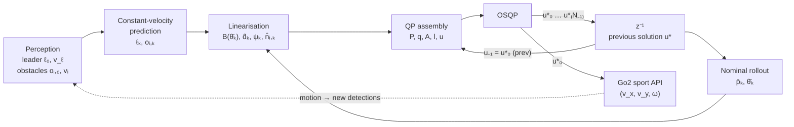
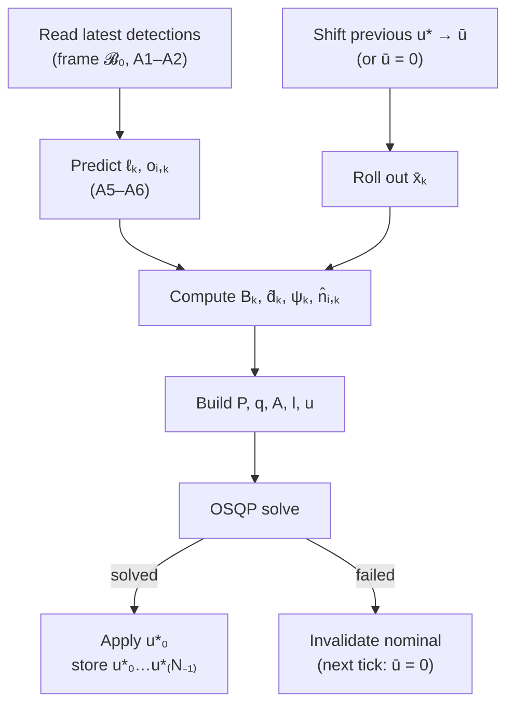

# Leader-Following MPC

Formal description of the receding-horizon controller implemented in
`LeaderFollower::compute_command()` (`src/main.cpp`).

The controller is a **linear time-varying MPC (LTV-MPC)**. At each tick it
linearises the nonlinear kinematics and the non-convex objectives around a
nominal trajectory obtained by shifting the previous optimal input sequence. It
then solves **one** convex QP (OSQP) and applies the first input. This
amounts to a single real-time iteration (RTI) of a sequential-QP scheme per
sampling instant.

Assumptions are labelled **A1, A2, …** and introduced where they are used.

---

## 1. Overview

| Symbol | Value | Meaning |
|---|---|---|
| $N$ | $20$ | prediction horizon (steps) |
| $\Delta t$ | $1/f$, $f=10\,\text{Hz}$ (ROS param `rate`) | sampling time, horizon $T = N\Delta t = 2\,\text{s}$ |
| $M$ | $10$ | max. number of obstacles considered |

---

## 2. Notation and frames

State and input:

$$
x = \begin{bmatrix} p_x \\ p_y \\ \theta \end{bmatrix} = \begin{bmatrix} p \\ \theta \end{bmatrix} \in \mathbb{R}^3,
\qquad
u = \begin{bmatrix} v_x \\ v_y \\ \omega \end{bmatrix} \in \mathbb{R}^3,
$$

where $p$ is the planar position, $\theta$ the yaw, and $u$ the commanded
**body-frame** linear velocities and yaw rate.

Let $\mathcal{B}_0$ be the robot body frame at the solve instant $t_0$. All
quantities in the OCP are expressed in $\mathcal{B}_0$ and treated as a fixed
(inertial) frame for the whole horizon.

> **A1 (frame).** All perception outputs (leader and obstacle positions and
> velocities) are expressed in $\mathcal{B}_0$. Velocities are relative to the
> ground (not to the robot), only resolved in $\mathcal{B}_0$. Consequently
> $x_0 = 0$.

> **A2 (latency).** Perception and actuation latency are neglected: the latest
> detections are taken to describe the world at $t_0$.

The input sequence is $\mathbf{u} = (u_0,\dots,u_{N-1})$ and the state
sequence is $\mathbf{x} = (x_0,\dots,x_N)$.

---

## 3. Plant model

The continuous-time kinematics of an omnidirectional base are

$$
\dot x = B(\theta)\,u,
\qquad
B(\theta) = \begin{bmatrix} \cos\theta & -\sin\theta & 0 \\ \sin\theta & \cos\theta & 0 \\ 0 & 0 & 1 \end{bmatrix}.
$$

> **A3 (kinematic plant).** The Unitree Go2 locomotion controller tracks the
> commanded body velocity perfectly and instantly. Leg dynamics, actuator lag
> and slip are ignored, so the robot is a pure kinematic integrator.

> **A4 (discretisation).** Forward Euler with zero-order-hold input:

$$
x_{k+1} = x_k + \Delta t\, B(\theta_k)\, u_k, \qquad k = 0,\dots,N-1.
$$

This is nonlinear (bilinear in $\cos\theta_k, \sin\theta_k$ and $u_k$), which
motivates §4.

Input constraints (box, SI units):

$$
\underline u \le u_k \le \overline u,
\qquad
\underline u = -\begin{bmatrix} 1 & 1 & 1 \end{bmatrix}^\top,\;
\overline u = \begin{bmatrix} 1 & 1 & 1 \end{bmatrix}^\top
\quad [\text{m/s},\,\text{m/s},\,\text{rad/s}].
$$

---

## 4. Linearisation about a nominal trajectory

### 4.1 Nominal input (warm-start shift)

Let $\mathbf u^{*,-} = (u^{*,-}_0,\dots,u^{*,-}_{N-1})$ be the optimal input
sequence of the previous tick. Since $u^{*,-}_0$ has just been applied, the
nominal input is the previous solution shifted by one step, with the last
element held:

$$
\bar u_k = u^{*,-}_{\min(k+1,\,N-1)}, \qquad k = 0,\dots,N-1.
$$

If the previous solve was unsuccessful (or there is none), $\bar u_k \equiv 0$.

Because $u$ is a body-frame velocity, $\bar{\mathbf u}$ does not change under
the frame change $\mathcal B_{-1}\to\mathcal B_0$. Only the rollout origin
moves, and it is $0$ by A1.

### 4.2 Nominal rollout

The nominal trajectory is generated with the same Euler model:

$$
\bar x_0 = 0, \qquad
\bar x_{k+1} = \bar x_k + \Delta t\, B(\bar\theta_k)\, \bar u_k .
$$

With $\bar u \equiv 0$ this gives $\bar x_k \equiv 0$, i.e. $B(\bar\theta_k)=I$.

### 4.3 Linearised (LTV) dynamics

The rotation is frozen along the nominal heading:

$$
\boxed{\,x_{k+1} = x_k + \Delta t\, B_k\, u_k, \qquad B_k := B(\bar\theta_k)\,}
$$

This is linear in $(x,u)$. The heading itself remains exact
($\theta_{k+1} = \theta_k + \Delta t\,\omega_k$). The approximation error is in
how the planar velocity is rotated whenever $\theta_k \ne \bar\theta_k$, and it
is small as long as the optimal heading stays close to the shifted previous
plan.

The nominal trajectory $(\bar p_k, \bar\theta_k)$ is also the linearisation
point for every geometric quantity below (line-of-sight directions, bearing,
obstacle normals).

---

## 5. Prediction of exogenous agents

Let $\ell_0, v_\ell$ be the leader's position and velocity, and $o_{i,0}, v_i$
the position and velocity of obstacle $i \in \{1,\dots,M_o\}$, $M_o \le M$.

> **A5 (constant velocity).** Leader and obstacles move with constant velocity
> over the horizon:

$$
\ell_{k} = \ell_0 + k\Delta t\, v_\ell, \qquad
o_{i,k} = o_{i,0} + k\Delta t\, v_i .
$$

> **A6 (static gating).** A velocity estimate that is not significant relative
> to its uncertainty is set to zero. With $\sigma$ the reported velocity
> standard deviation,
> $\;\lVert v\rVert < 2\sigma \;\Rightarrow\; v := 0$.

The predictions do not depend on the robot's decisions. There is no
interaction model, so the leader does not react to the robot.

---

## 6. Objective

All stage costs are evaluated on $x_{k+1}$, $k = 0,\dots,N-1$. There is no
separate terminal cost, so $x_N$ is penalised like any other stage.

### 6.1 Leader distance (2 m standoff)

The goal is $\lVert \ell_{k+1} - p_{k+1}\rVert = r_\ell$ with $r_\ell = 2\,\text{m}$.
The norm is non-convex in $p$, so it is linearised at the nominal $\bar p_{k+1}$.
Define the line-of-sight unit vector

$$
\hat d_k = \frac{\ell_{k+1} - \bar p_{k+1}}{\lVert \ell_{k+1} - \bar p_{k+1}\rVert}.
$$

First-order Taylor expansion:

$$
\lVert \ell_{k+1} - p\rVert \approx \lVert \ell_{k+1} - \bar p_{k+1}\rVert - \hat d_k^\top (p - \bar p_{k+1}) = \hat d_k^\top(\ell_{k+1} - p).
$$

The resulting stage cost is

$$
J^{d}_k = \frac{Q_d}{2}\Big(\hat d_k^\top(\ell_{k+1} - p_{k+1}) - r_\ell\Big)^2 .
$$

This cost only penalises error *along* the line of sight. Lateral displacement
is free in this term and is handled by the bearing term below.

> **A7 (well-posed line of sight).** $\lVert \ell_{k+1} - \bar p_{k+1}\rVert > 0$
> (the nominal never coincides with the leader). Otherwise $\hat d_k$ is
> undefined.

### 6.2 Leader centring in the FOV (heading)

The leader should be kept centred in the camera field of view, so the yaw
should point at the leader. The bearing to the leader from the nominal pose is
$\operatorname{atan2}(\hat d_{k,y}, \hat d_{k,x})$. To avoid $2\pi$ jumps
between stages, the reference is unwrapped relative to the nominal heading:

$$
\psi_k = \bar\theta_{k+1} + \operatorname{wrap}_{[-\pi,\pi)}\!\Big(\operatorname{atan2}(\hat d_{k,y}, \hat d_{k,x}) - \bar\theta_{k+1}\Big),
$$

$$
J^{\theta}_k = \frac{Q_\theta}{2}\,(\theta_{k+1} - \psi_k)^2 .
$$

The bearing depends on $p_{k+1}$ but is frozen at $\bar p_{k+1}$, which is the
same zeroth-order approximation as for $\hat d_k$.

### 6.3 Input effort and input rate

$$
J^{u}_k = \frac12\, u_k^\top R\, u_k,
\qquad
J^{\Delta u}_k = \frac12\,(u_k - u_{k-1})^\top S\,(u_k - u_{k-1}),
$$

with $u_{-1} := u^{*,-}_0$, the command actually sent at the previous tick
($u_{-1} = 0$ if there is no valid previous solution). The rate term penalises
jerk across ticks as well as within the horizon.

### 6.4 Total cost and weights

$$
J(\mathbf x,\mathbf u,\mathbf s) = \sum_{k=0}^{N-1}\Big( J^{d}_k + J^{\theta}_k + J^{u}_k + J^{\Delta u}_k + \frac{\rho}{2}\sum_{i=1}^{M} s_{i,k}^2 \Big),
$$

where $s_{i,k}$ are the obstacle slacks from §7.2.

| Weight | Value |
|---|---|
| $Q_d$ | $8$ |
| $Q_\theta$ | $0.5$ |
| $R$ | $\operatorname{diag}(7.5,\ 7.5,\ 0.5)$ |
| $S$ | $\operatorname{diag}(3,\ 3,\ 1)$ |
| $\rho$ | $50$ |

---

## 7. Constraints

### 7.1 Initial condition, dynamics, inputs

$$
x_0 = 0, \qquad
x_{k+1} = x_k + \Delta t\, B_k u_k, \qquad
\underline u \le u_k \le \overline u, \qquad k=0,\dots,N-1 .
$$

### 7.2 Obstacle avoidance (linearised, soft-hard margin)

The exact requirement $\lVert o_{i,k+1} - p_{k+1}\rVert \ge r$ describes the
complement of a disk, which is non-convex. It is replaced by a half-plane
whose normal is the line of sight from the nominal pose:

$$
\hat n_{i,k} = \frac{o_{i,k+1} - \bar p_{k+1}}{\lVert o_{i,k+1} - \bar p_{k+1}\rVert},
$$

$$
\boxed{\;\hat n_{i,k}^\top\big(o_{i,k+1} - p_{k+1}\big) \;\ge\; r_s - s_{i,k},
\qquad 0 \le s_{i,k} \le r_s - r_h \;}
$$

with soft margin $r_s = 2\,\text{m}$ and hard margin $r_h = 1\,\text{m}$.

**Interpretation.**
- $\hat n^\top(o - p)$ is the distance from $p$ to the plane through $o$ with
  normal $\hat n$. By Cauchy–Schwarz,
  $\lVert o - p\rVert \ge \hat n^\top(o-p)$, so the half-plane is a **convex
  inner approximation** of the true free space $\lVert o-p\rVert \ge r$. It is
  exact at $p = \bar p_{k+1}$.
- For a slack $s$, the clearance is at least $r_s - s$. The bound
  $s \le r_s - r_h$ makes $r_h$ a **hard** clearance and $r_s$ a **preferred**
  one. Clearance between $r_h$ and $r_s$ is allowed at quadratic cost
  $\tfrac{\rho}{2}s^2$.

> **A8 (nearest-point obstacles).** Each detection $o_{i,0}$ is the point of the
> obstacle closest to the robot. Then the plane through $o_i$ normal to the line
> of sight is a supporting plane, and the whole obstacle lies behind it. This
> holds exactly at $t_0$ and is assumed to hold approximately along the horizon
> (the nearest point is not re-evaluated for $\bar p_{k+1} \ne 0$). The margins
> $r_h, r_s$ are therefore measured from the obstacle surface to the robot
> centre and must account for the robot's own footprint.

> **A9 (quadratic slack).** The slack penalty is purely quadratic. This is a
> deliberate choice: it is not an exact penalty, so $r_s$ may be slightly
> violated even when it is feasible, in exchange for smooth trade-offs with
> the tracking terms.

> **A10 (bounded obstacle set).** At most $M=10$ obstacles, chosen as the
> nearest ones, are considered. For unused indices the half-plane row has bounds
> $(-\infty,\infty)$ and the slack is driven to $0$ by its cost.

> **A11 (well-posed normal).** $\lVert o_{i,k+1} - \bar p_{k+1}\rVert > 0$.

---

## 8. The QP

### 8.1 Optimal control problem

$$
\begin{aligned}
\min_{\mathbf x,\mathbf u,\mathbf s}\quad & J(\mathbf x,\mathbf u,\mathbf s) \\
\text{s.t.}\quad & x_0 = 0, \\
& x_{k+1} = x_k + \Delta t\, B_k u_k, && k = 0,\dots,N-1, \\
& \underline u \le u_k \le \overline u, && k = 0,\dots,N-1, \\
& \hat n_{i,k}^\top(o_{i,k+1} - p_{k+1}) + s_{i,k} \ge r_s, && i = 1,\dots,M_o, \\
& 0 \le s_{i,k} \le r_s - r_h, && i = 1,\dots,M .
\end{aligned}
$$

$B_k, \hat d_k, \psi_k, \hat n_{i,k}, \ell_{k+1}, o_{i,k+1}$ are all fixed data
at solve time. The cost is a convex quadratic and the constraints are affine,
so the problem is a convex QP.

### 8.2 OSQP standard form

The problem is solved in sparse (non-condensed) form, with the states kept
as decision variables:

$$
z = \begin{bmatrix} x_0^\top & \cdots & x_N^\top & u_0^\top & \cdots & u_{N-1}^\top & s_{\cdot,0}^\top & \cdots & s_{\cdot,N-1}^\top \end{bmatrix}^\top \in \mathbb R^{3(N+1) + 3N + MN},
$$

$$
\min_z\ \tfrac12 z^\top P z + q^\top z \quad \text{s.t.}\quad l \le A z \le u .
$$

For $N=20$, $M=10$: $\dim z = 323$ and $A$ has $3 + N(6 + 2M) = 523$ rows.

**Cost blocks** (constants dropped):

$$
P = \operatorname{blkdiag}\big(P_x,\; P_u,\; \rho I_{MN}\big),
$$

$$
P_x:\ \text{block } x_{k+1} = \begin{bmatrix} Q_d \hat d_k \hat d_k^\top & 0 \\ 0 & Q_\theta \end{bmatrix},
\qquad
q_{x_{k+1}} = -\begin{bmatrix} Q_d\, c_k\, \hat d_k \\ Q_\theta\, \psi_k \end{bmatrix},
\quad c_k = \hat d_k^\top \ell_{k+1} - r_\ell,
$$

$$
P_u = I_N \otimes R \;+\; D^\top (I_N \otimes S)\, D,
\qquad
q_{u_0} = -S\,u_{-1},
$$

where $D$ is the block first-difference operator
($(D\mathbf u)_0 = u_0$, $(D\mathbf u)_k = u_k - u_{k-1}$). $P_u$ is therefore
block-tridiagonal: diagonal blocks $R + 2S$ ($R + S$ for the last one) and
off-diagonal blocks $-S$. Only the upper triangle is passed to OSQP.

**Constraint rows** for $k = 0,\dots,N-1$ (after the 3 initial-condition rows
$x_0 = 0$):

$$
\begin{array}{lll}
\text{dynamics (3):} & x_{k+1} - x_k - \Delta t B_k u_k & \in [0,\,0] \\
\text{input box (3):} & u_k & \in [\underline u,\, \overline u] \\
\text{obstacle } i\ (M): & -\hat n_{i,k}^\top p_{k+1} + s_{i,k} & \in [\,r_s - \hat n_{i,k}^\top o_{i,k+1},\ \infty) \\
\text{slack } i\ (M): & s_{i,k} & \in [0,\ r_s - r_h]
\end{array}
$$

**Implementation remarks.**
- The sparsity pattern of $P$ and $A$ does not change between ticks: unused
  obstacle rows are kept with explicit zero entries and infinite bounds. This
  allows `osqp_update_data_mat` / `osqp_update_data_vec` instead of a new
  setup, so the KKT factorisation structure and the warm start are kept.
- The solver time limit is $0.5\,\Delta t$. `SOLVED_INACCURATE` is accepted.

---

## 9. Receding-horizon law

At each tick $t_0$:

The control law is

$$
u(t_0) = \kappa_{\text{MPC}}\big(\ell_0, v_\ell, \{o_{i,0}, v_i\}, \mathbf u^{*,-}\big) := u_0^*,
$$

held constant over $[t_0, t_0 + \Delta t)$. The full sequence $\mathbf u^*$ is
stored and becomes $\mathbf u^{*,-}$ (nominal and $u_{-1}$) at the next tick.

The controller has an internal state: through the nominal and the rate
penalty, the law depends on the previous solution as well as on the current
measurements.

---

## Assumptions summary

| # | Assumption |
|---|---|
| A1 | Everything in body frame $\mathcal B_0$ at solve time, $x_0 = 0$; agent velocities ground-relative |
| A2 | Latency neglected |
| A3 | Go2 is a perfect body-velocity tracker (kinematic plant) |
| A4 | Forward-Euler discretisation, ZOH input |
| A5 | Leader and obstacles move with constant velocity |
| A6 | Velocity set to zero if $\lVert v\rVert < 2\sigma$ |
| A7 | Nominal never coincides with leader |
| A8 | Obstacle detections are nearest surface points; supporting-plane property assumed along horizon |
| A9 | Quadratic (non-exact) slack penalty, deliberate |
| A10 | At most $M=10$ nearest obstacles |
| A11 | Nominal never coincides with an obstacle point |

Not covered here: supervisory logic (leader acquisition and ID tracking,
leader timeout, nearest-$M$ selection, STOP handling).
