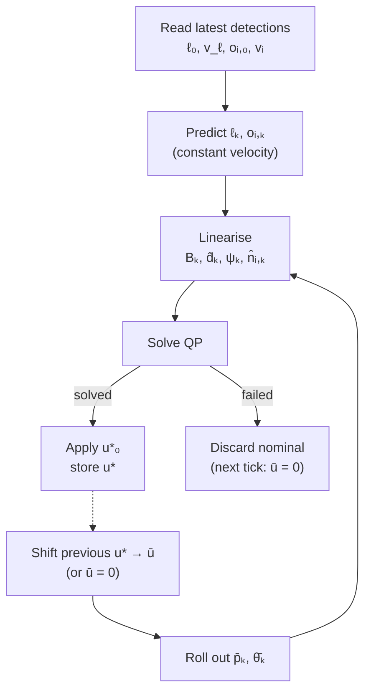

# Leader-Following MPC

At each tick the controller predicts the leader and obstacles over a short horizon
and solves one convex QP for the robot's body-velocity commands. The QP keeps the
robot a fixed distance from the leader, turned to face it, and clear of obstacles.
The nonlinear kinematics and the non-convex distance terms are linearised around the
previous optimal input sequence, shifted by one step. Only the first input is applied
(receding horizon).

---

## 1. Notation

| Symbol | Value | Meaning |
|---|---|---|
| $N$ | $20$ | prediction horizon |
| $\Delta t$ | $0.1\,\text{s}$ | sampling time ($1/\text{rate}$) |
| $x_k = [p_k^\top,\ \theta_k]^\top \in \mathbb R^3$ | | robot position $p_k$ and yaw $\theta_k$ |
| $u_k = [v_{x,k},\ v_{y,k},\ \omega_k]^\top \in \mathbb R^3$ | | body-frame velocity command |
| $\bar p_k,\ \bar\theta_k$ | | nominal pose, rolled out from the previous solution |
| $\ell_k,\ v_\ell$ | | leader position and velocity |
| $o_{i,k},\ v_i$ | | position and velocity of obstacle $i = 1,\dots,M$, $M \le 10$ |
| $m_\ell$ | $2\,\text{m}$ | leader distance |
| $m_s,\ m_h$ | $2\,\text{m},\ 1\,\text{m}$ | soft and hard obstacle margins |
| $s_{i,k} \ge 0$ | | obstacle slack |

Everything is expressed in the robot body frame at the solve instant, so $x_0 = 0$.
Agent velocities are relative to the ground. Latency is neglected.

---

## 2. Plant model

The Go2 is treated as an ideal omnidirectional body-velocity tracker (no leg dynamics
or slip). With forward Euler:

$$
x_{k+1} = x_k + \Delta t\, B(\theta_k)\, u_k,
\qquad
B(\theta) = \begin{bmatrix} \cos\theta & -\sin\theta & 0 \\ \sin\theta & \cos\theta & 0 \\ 0 & 0 & 1 \end{bmatrix}.
$$

To make this linear, the rotation is frozen along the nominal heading,
$B_k := B(\bar\theta_k)$. The nominal is the previous solution $u^-$ shifted by one
step, $\bar u_k = u^-_{\min(k+1,\,N-1)}$, then rolled out:

$$
\bar x_0 = 0, \qquad \bar x_{k+1} = \bar x_k + \Delta t\, B(\bar\theta_k)\,\bar u_k .
$$

If there is no valid previous solution, $\bar u_k = 0$ and $B_k = I$.

---

## 3. Leader model

The leader moves at constant velocity:

$$
\ell_k = \ell_0 + k\Delta t\, v_\ell .
$$

Velocity estimates that are not significant are zeroed: $\lVert v_\ell\rVert < 2\sigma_\ell \Rightarrow v_\ell := 0$.

The direction to the leader from the nominal pose is

$$
\hat d_k = \frac{\ell_{k+1} - \bar p_{k+1}}{\lVert \ell_{k+1} - \bar p_{k+1}\rVert}.
$$

---

## 4. Obstacle model

Each detection $o_{i,0}$ is the obstacle point nearest to the robot. Obstacles also
move at constant velocity, with the same $2\sigma$ gating:

$$
o_{i,k} = o_{i,0} + k\Delta t\, v_i .
$$

The direction to each obstacle from the nominal pose is

$$
\hat n_{i,k} = \frac{o_{i,k+1} - \bar p_{k+1}}{\lVert o_{i,k+1} - \bar p_{k+1}\rVert}.
$$

At most the $10$ nearest obstacles are used.

---

## 5. Constraints

For $k = 0,\dots,N-1$ and $i = 1,\dots,M$:

$$
\begin{aligned}
& x_0 = 0, \\
& x_{k+1} = x_k + \Delta t\, B_k u_k, \\
& -1 \le u_k \le 1, \\
& \hat n_{i,k}^\top\big(o_{i,k+1} - p_{k+1}\big) \ge m_s - s_{i,k}, \\
& 0 \le s_{i,k} \le m_s - m_h .
\end{aligned}
$$

The obstacle constraint replaces the non-convex disk exclusion
$\lVert o - p\rVert \ge m$ with a half-plane that touches the disk at the nominal.
Since $\lVert o-p\rVert \ge \hat n^\top(o-p)$, the half-plane is a conservative
convex approximation. The slack makes $m_h$ a hard clearance and $m_s$ a preferred
one.

---

## 6. Objective function

The leader error is stacked into one vector:

$$
o_k = \begin{bmatrix}
\hat d_k^\top(\ell_{k+1} - p_{k+1}) - m_\ell \\
\psi_k - \theta_{k+1}
\end{bmatrix},
\qquad
\psi_k = \operatorname{atan2}(\hat d_{k,y},\ \hat d_{k,x}).
$$

The first row is the linearised distance to the leader minus $m_\ell$. The second
row is the bearing error, which keeps the leader centred in the camera. $\psi_k$ is
unwrapped relative to $\bar\theta_{k+1}$ to avoid $2\pi$ jumps.

$$
J = \sum_{k=0}^{N-1} \Big(
o_k^\top Q\, o_k
+ u_k^\top R\, u_k
+ (u_k - u_{k-1})^\top S\, (u_k - u_{k-1})
+ c_m \sum_{i=1}^{M} s_{i,k}^2
\Big),
$$

with $u_{-1}$ the command sent at the previous tick ($0$ if there is none).

| Weight | Value |
|---|---|
| $Q$ | $\operatorname{diag}(8,\ 0.5)$ |
| $R$ | $\operatorname{diag}(7.5,\ 7.5,\ 0.5)$ |
| $S$ | $\operatorname{diag}(3,\ 3,\ 1)$ |
| $c_m$ | $50$ |

$J$ is convex quadratic and every constraint is affine, so the problem is a QP.

---

## 7. Conclusion

At each tick:

$$
u^\star = \arg\min_{x,\,u,\,s}\ J \quad \text{s.t. §5},
\qquad
u(t_0) = u^\star_0 .
$$

$u^\star_0$ is applied for one $\Delta t$. The full sequence $u^\star$ is stored, and at
the next tick it supplies the nominal and $u_{-1}$.

